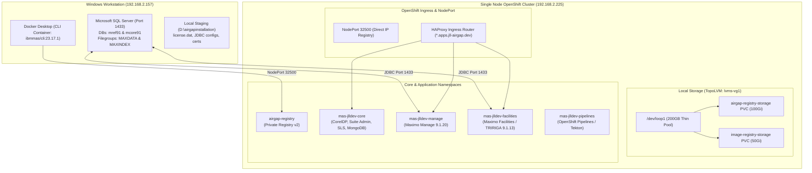

# IBM Maximo Application Suite (MAS 9.1.20) Air-Gap Setup & Installation Runbook

**Target Platform:** Single Node OpenShift (SNO) v4.22.18 on Bare-Metal  
**MAS Version:** 9.1.20 | **Channel:** `9.1.x` | **Catalog:** `v9-260730-amd64`  
**Applications Installed:** Maximo Manage (v9.1.20) & Maximo Facilities (TRIRIGA v9.1.13)  
**Database Backend:** Microsoft SQL Server on Windows Workstation (`192.168.2.157`)  

---

## 1. System Architecture & Topology

The environment is deployed on an air-gapped **Single Node OpenShift (SNO)** cluster hosted on a bare-metal Dell server, supported by an external Windows workstation acting as the bastion host, container runner, and database server.



### Key Environment Specifications

| Component | Specification / Value | Description |
| :--- | :--- | :--- |
| **Cluster Node** | `00-be-43-80-03-43` (`192.168.2.225`) | SNO OpenShift 4.22.18 |
| **API Endpoint** | `https://api.jll-airgap.dev:6443` | Cluster API |
| **Ingress Domain** | `*.apps.jll-airgap.dev` | Wildcard application routes |
| **Bastion Host** | Windows 11 Workstation (`192.168.2.157`) | Docker Desktop & SQL Server |
| **MAS Instance / WS** | Instance: `jlldev` \| Workspace: `dev` | Target suite deployment |
| **Storage Class** | `lvms-vg1` (`topolvm.io`, RWO) | Thin pool backed by `/dev/loop1` |
| **Private Registry** | `192.168.2.225:32500` (`jllairgap`) | LoadBalancer / NodePort service |
| **Registry Credentials**| `jllairgap` / `jllairgap@2026` | Injected into Global Pull Secret |

---

## 2. Pre-requisites & Readiness Audit

Before commencing air-gap mirroring or MAS deployment, verify the following baseline prerequisites:

### A. Windows Bastion & Tooling
1. **Docker Desktop**: Installed and running with Linux container support enabled.
2. **MAS CLI Container**: Image `quay.io/ibmmas/cli:23.17.1` pulled locally.
   - Run container with workspace mounts:
     ```powershell
     docker run -dit --name ibmmas-cli `
       -v D:\airgapinstallation\mirrorfiles:/mnt/registry `
       -v C:\Users\JLLRND1\.kube:/root/.kube `
       quay.io/ibmmas/cli:23.17.1 bash
     ```
3. **OpenShift CLI (`oc`)**: Present inside container and validated:
   ```bash
   oc login -u kubeadmin -p <password> https://api.jll-airgap.dev:6443
   ```

### B. Microsoft SQL Server Setup
Both Maximo Manage and Maximo Facilities require dedicated databases on Microsoft SQL Server:

1. **TCP/IP Protocol**: Must be explicitly enabled in SQL Server Configuration Manager (or Registry) and listening on port `1433`:
   ```powershell
   Set-ItemProperty -Path 'HKLM:\SOFTWARE\Microsoft\Microsoft SQL Server\MSSQL17.MSSQLSERVER\MSSQLServer\SuperSocketNetLib\Tcp' -Name 'Enabled' -Value 1
   Restart-Service MSSQLSERVER -Force
   ```
2. **Databases & Logins**:
   - Maximo Facilities (TRIRIGA): Database `mref91`, Login `mref91`, Password `mref91`.
   - Maximo Manage: Database `mcore91`, Login `mcore91`, Password `mcore91`.
3. **Required Filegroups (Manage Pre-requisite)**:
   Maximo's database installation (`maxinst`) strictly requires two auxiliary filegroups. Execute on `mcore91`:
   ```sql
   ALTER DATABASE [mcore91] ADD FILEGROUP [MAXDATA];
   ALTER DATABASE [mcore91] ADD FILE (NAME = N'mcore91_data', FILENAME = N'D:\MSSQL2025\Data\mcore91_data.ndf', SIZE = 5120MB, FILEGROWTH = 256MB) TO FILEGROUP [MAXDATA];

   ALTER DATABASE [mcore91] ADD FILEGROUP [MAXINDEX];
   ALTER DATABASE [mcore91] ADD FILE (NAME = N'mcore91_idx', FILENAME = N'D:\MSSQL2025\Data\mcore91_idx.ndf', SIZE = 2048MB, FILEGROWTH = 128MB) TO FILEGROUP [MAXINDEX];
   ```

### C. Storage & Hardware Constraints
- **Bare-Metal SNO vs Multi-Node AWS EFS**: Standard IBM guides reference AWS EFS shared storage. On a Dell Bare-Metal SNO, all shared persistent storage is provided via local TopoLVM (`lvms-vg1`). Applications must be configured with `ReadWriteOnce` (RWO) access modes.
- **Node Memory**: SNO requires careful memory quota management. Default bundle requests of 2Gi+ per component can exhaust allocatable RAM.

### D. Licenses & Entitlements
- Staged IBM MAS License File: `license.dat` (stored at `D:\airgapinstallation\mas\license.dat`).
- IBM Entitlement Key: Required during image mirroring from `cp.icr.io`.

---

## 3. Phase 1: Airgap Registry Setup & Storage Resolution

### Step 1: Deploy Private Registry in OpenShift
1. Create namespace `airgap-registry`.
2. Provision a 100Gi PVC `airgap-registry-storage` using StorageClass `lvms-vg1`.
3. Deploy the registry pod and expose it via:
   - **Service `airgap-registry-lb`**: Type `LoadBalancer` mapping port `5000` to NodePort `32500`.
   - **Route `airgap-registry`**: Passthrough route on `airgap-registry.apps.jll-airgap.dev`.

### Step 2: Resolving the LVM Storage Deadlock (Root Cause Analysis)
During setup, `airgap-registry-storage` hung indefinitely in `Pending`. The investigation revealed:
- **Rogue Operator**: A duplicate LVMS operator was installed in `openshift-lvm-storage` targeting `/dev/nvme1n1` (which did not exist).
- **Lock Contention**: The rogue daemon acquired `/var/lock/vgmanager/vgmanager.lock`, causing the legitimate LVMS daemon in `openshift-storage` (`vg-manager-ht4zv`) to stall.
- **Resolution**:
  ```bash
  # 1. Delete broken LVMCluster and CSV in openshift-lvm-storage
  oc delete lvmcluster jll-airgap -n openshift-lvm-storage
  oc delete sub lvms-operator -n openshift-lvm-storage
  oc delete csv lvms-operator.v4.22.0 -n openshift-lvm-storage

  # 2. Release host lock and clean stale device-mapper entries on node
  rm -f /var/lock/vgmanager/vgmanager.lock
  dmsetup remove -f /dev/mapper/vg1-*
  rm -rf /dev/vg1

  # 3. Restart healthy vg-manager daemon
  oc delete pod vg-manager-ht4zv -n openshift-storage
  ```
- **Outcome**: Volume Group `vg1` and `thin-pool-1` initialized successfully on `/dev/loop1`. TopoLVM registered, and PVC bound immediately.

### Step 3: Configure Cluster Trust & Pull Secrets
1. **Extract Registry CA**: Save `ca.crt` to `/mnt/registry/ca.crt`.
2. **Inject into OpenShift Trusted CA**:
   ```bash
   oc create configmap registry-cas -n openshift-config --from-file=192.168.2.225..32500=/mnt/registry/ca.crt
   oc patch image.config.openshift.io/cluster --type=merge -p '{"spec":{"additionalTrustedCA":{"name":"registry-cas"}}}'
   ```
3. **Configure Insecure Registry Bypass for Node CRI-O**:
   Because Go's TLS validator rejects IP SAN certificates when accessed via raw IP, configure CRI-O insecure registry:
   ```bash
   oc patch image.config.openshift.io/cluster --type=merge -p '{"spec":{"registrySources":{"insecureRegistries":["192.168.2.225:32500"]}}}'
   ```
4. **Update Global Cluster Pull Secret**:
   Add base64 credentials for `192.168.2.225:32500` (`user: jllairgap`, `password: jllairgap@2026`) into `openshift-config/pull-secret`.

---

## 4. Phase 2: Image Mirroring Deep Dive

### Understanding Mirror Modes

The MAS CLI provides three distinct mirroring operations:

```
                  +----------------------------------------------+
                  |         Remote Internet Registries          |
                  |         (cp.icr.io / quay.io)                |
                  +----------------------------------------------+
                               /                   \
                 Mode 1: Direct                     Mode 2: To-Filesystem
                             /                       \
                            v                         v
              +--------------------------+     +--------------------------+
              | Target Private Registry  |     |   Local Disk / Storage   |
              | (192.168.2.225:32500)    |     | (/mnt/registry / D:\...) |
              +--------------------------+     +--------------------------+
                            ^                         |
                             \                       /
                              \                     /
                             Mode 3: From-Filesystem
```

1. **Mode 1 (`direct`)**: Streams images straight from IBM/Quay into the private registry without saving intermediate files to disk. Ideal when the bastion has network access to both the internet and OpenShift.
2. **Mode 2 (`to-filesystem`)**: Downloads images from IBM/Quay into local files (`D:\airgapinstallation\mirrorfiles`). Requires internet access and Entitlement Key.
3. **Mode 3 (`from-filesystem`)**: Pushes local image files from disk into the private registry. Requires only private registry access (no internet required).

### Execution Parameters for `mas mirror-images`

#### Catalog Metadata Patch for OCP 4.22
Because MAS CLI `23.17.1` officially catalogues support up to OCP `4.21`, patch the catalog loader inside the container:
```python
# patch_catalog.py
import json
with open('/mascli/catalog/v9-260730-amd64.json', 'r') as f:
    data = json.load(f)
if "4.22" not in data["ocp_compatibility"]:
    data["ocp_compatibility"].append("4.22")
with open('/mascli/catalog/v9-260730-amd64.json', 'w') as f:
    json.dump(data, f)
```

#### Running the Mirror Process
To execute image mirroring (Direct Mode):
```bash
mas mirror-images \
  -m direct \
  -d /mnt/registry \
  -H 192.168.2.225 \
  -P 32500 \
  -x jllairgap \
  -u jllairgap \
  -p jllairgap@2026 \
  -c v9-260730-amd64 \
  -C 9.1.x \
  --ibm-entitlement <YOUR_IBM_ENTITLEMENT_KEY> \
  --mirror-catalog \
  --mirror-core \
  --mirror-manage \
  --mirror-facilities \
  --mirror-sls \
  --mirror-tsm \
  --mirror-mongo \
  --mirror-odf \
  --mirror-cli \
  --no-confirm
```

#### Mirrored Artifacts & Versions
- **Catalog**: `v9-260730-amd64`
- **MAS Core Platform**: `9.1.20`
- **Maximo Manage**: `9.1.20`
- **Maximo Facilities (MREF)**: `9.1.13`
- **Dependencies**: SLS `3.13.0`, TSM `1.7.7`, MongoDB CE `8.0.23`, ODF `4.15`
- **ImageDigestMirrorSet (IDMS)**: Applied `mas-ibm-catalog-jllairgap` to redirect all image pulls from `cp.icr.io` to `192.168.2.225:32500/jllairgap`.

---

## 5. Phase 3: Pre-Installation Cluster Services

### 1. OpenShift Pipelines (Tekton) Deployment
MAS deployment utilizes Tekton pipelines under the hood:
1. Installed **Red Hat OpenShift Pipelines Operator** v1.24.3 in `openshift-operators`.
2. Verified all Tekton control plane pods (`pipelines`, `triggers`, `chains`) reached `1/1 Running`.

### 2. OpenShift Internal Image Registry Setup
Maximo Manage builds custom Liberty and DB container images directly on the cluster during workspace initialization. This requires the internal cluster image registry to be operational:
1. Provisioned a 50Gi PVC `image-registry-storage` on `lvms-vg1`.
2. Configured the registry operator:
   ```bash
   oc patch configs.imageregistry.operator.openshift.io/cluster --type=merge -p '{
     "spec": {
       "managementState": "Managed",
       "rolloutStrategy": "Recreate",
       "storage": {
         "pvc": {
           "claim": "image-registry-storage"
         }
       },
       "defaultRoute": true
     }
   }'
   ```
3. Verified `image-registry.openshift-image-registry.svc:5000` is active.

### 3. Staging Application Configurations

Staged in `D:\airgapinstallation\mas\` (mounted to `/mnt/registry/mas/` in the CLI container):

#### A. Facilities Configuration (`facilities-config.yaml`)
```yaml
apiVersion: v1
kind: ConfigMap
metadata:
  name: facilities-config
  namespace: mas-jlldev-pipelines
data:
  mas_ws_facilities_storage_log_size: "30"
  mas_ws_facilities_storage_userfiles_size: "50"
  mas_ws_facilities_db_maxconnpoolsize: "200"
  mas_ws_facilities_dwfagents: "[]"
```

#### B. Facilities SQL Server JDBC (`jdbc-jlldev-facilities.yaml`)
```yaml
apiVersion: config.mas.ibm.com/v1
kind: JdbcCfg
metadata:
  name: jlldev-facilities-jdbc
  namespace: mas-jlldev-core
spec:
  config:
    url: "jdbc:sqlserver://192.168.2.157:1433;databaseName=mref91;encrypt=false;trustServerCertificate=true;"
    user: "mref91"
    password: "mref91"
  scope: "workspace"
  workspaceId: "dev"
```

#### C. Manage SQL Server JDBC (`jdbc-jlldev-manage.yaml`)
```yaml
apiVersion: config.mas.ibm.com/v1
kind: JdbcCfg
metadata:
  name: jlldev-manage-jdbc
  namespace: mas-jlldev-core
spec:
  config:
    url: "jdbc:sqlserver://192.168.2.157:1433;databaseName=mcore91;encrypt=false;trustServerCertificate=true;"
    user: "mcore91"
    password: "mcore91"
  scope: "workspace"
  workspaceId: "dev"
```

---

## 6. Phase 4: MAS Pipeline Installation (`mas install`)

### Executing the Installer
Launch the installation from the CLI container:
```bash
mas install \
  --mas-instance-id jlldev \
  --mas-workspace-id dev \
  --mas-workspace-name "JLL Development" \
  --mas-catalog-version v9-260730-amd64 \
  --mas-channel 9.1.x \
  --license-file /mnt/registry/mas/license.dat \
  --ibm-entitlement <YOUR_KEY> \
  --storage-class lvms-vg1 \
  --storage-accessmode ReadWriteOnce \
  --install-manage \
  --install-facilities
```

### Pipeline Tasks Executed (PipelineRun `jlldev-install-261103-1255-00eq0h`)
1. `pipeline-start`: Initializes workspace config.
2. `ibm-catalogs`: Injects offline CatalogSources backed by mirrored registry.
3. `cert-manager` & `suite-certs`: Provisions cluster-issuer and TLS certificates.
4. `mongodb`: Provisions MongoDB Community Edition 8.0 cluster for suite metadata.
5. `sls`: Deploys Suite License Service and bootstraps `license.dat`.
6. `dro` & `bas`: Installs Data Reporter Operator and Business Activity Services.
7. `suite-install`: Deploys IBM MAS Core Operator and reconciles Suite CR `jlldev`.
8. `suite-config`: Binds SLS, MongoDB, and SystemDB to MAS Core.
9. `app-install-manage`: Generates Manage build configs, runs `maxinst`, and provisions bundle pods.
10. `app-install-facilities`: Provisions TRIRIGA data initialization, runs schema updates, and deploys Liberty app servers.

---

## 7. Critical Post-Install Blockers & Remediation

During the automated rollout, multiple environmental and configuration issues occurred and were resolved:

### 1. SQL Server Missing Filegroup Error in Maximo Manage
- **Symptom**: `app-install-manage` task failed during `maxinst.sh` with:
  ```
  Invalid filegroup 'MAXDATA' specified.
  ```
- **Root Cause**: Maximo Manage DDL requires SQL Server tables and indexes to be partitioned across `MAXDATA` and `MAXINDEX` filegroups. Default database creation only provides `PRIMARY`.
- **Fix**: Executed DDL on Windows SQL Server (`192.168.2.157`) to create the filegroups and add physical data files to `mcore91`.

### 2. Single Node OpenShift Memory Deadlock (`ManageServerBundle/all`)
- **Symptom**: Maximo Manage server bundle pod `jlldev-dev-all-dddc9cd55-gwd6f` stuck in `Pending`:
  ```
  0/1 nodes available: 1 Insufficient memory.
  ```
- **Root Cause**: The operator requested 2Gi of memory for the `all` container and 500Mi for `monitoragent`. SNO allocatable memory was at 1.98Gi available.
- **Fix**: Patched `ManageServerBundle/all` and its deployment resource requests:
  ```bash
  oc patch manageserverbundle jlldev-dev-all -n mas-jlldev-manage --type=merge -p '{
    "spec": {
      "settings": {
        "resources": {
          "requests": {"cpu": "100m", "memory": "50Mi"}
        }
      }
    }
  }'
  ```
- **Result**: Pod immediately scheduled and transitioned to `2/2 Running`. Internal ping verified:
  ```bash
  curl -ksi https://localhost:9443/maximo/api/ping?ready=1
  # Returned: HTTP/1.1 200 OK {"mxserverstarted": true}
  ```

### 3. Facilities Storage Access Mode Mismatch (RWX vs RWO)
- **Symptom**: TRIRIGA appserver PVCs failed to bind.
- **Root Cause**: Operator default templates requested `ReadWriteMany` (RWX), which is unsupported by the local TopoLVM driver (`lvms-vg1`).
- **Fix**: Re-created PVC definitions (`log-jlldev-dev-appserver-0`, `userfiles-jlldev-dev-appserver-0`, `jlldev-dev-multiagents-log`, `jlldev-dev-multiagents-userfiles`) with `accessModes: ["ReadWriteOnce"]`.

### 4. CoreIDP Startup Probe Timeout & API Warmup
- **Symptom**: `https://admin.jlldev.apps.jll-airgap.dev` displayed OpenShift error:
  ```
  Application is not available (503 Service Unavailable)
  ```
- **Root Cause**: `jlldev-coreidp` was cold-starting its internal JAX-RS services (`api-usermgmt-internal`). The initial response took 43 seconds, exceeding the default 20-second startup probe timeout and causing kubelet to restart the container in a loop.
- **Fix**: Increased probe timeouts and executed direct warm-up curl requests against `api/probes/readiness` and `idplogin/probes/readiness`. Response time dropped to <2s, and `coreidp` reached `1/1 Running`.

### 5. Windows Client DNS Resolution (`DNS_PROBE_FINISHED_NXDOMAIN`)
- **Symptom**: Browsing to `auth.jlldev.apps.jll-airgap.dev` failed on Windows with `DNS_PROBE_FINISHED_NXDOMAIN`.
- **Root Cause**: Windows `hosts` file had invalid entries (wildcards like `*.apps...` and URL paths with `/login` are not supported by the Windows DNS resolver).
- **Fix**: Created and executed the automation script [`update_hosts.ps1`](file:///C:/Users/JLLRND1/update_hosts.ps1) to inject clean, exact FQDN mappings pointing to `192.168.2.225`.

---

## 8. Verified Endpoints & Credentials

### Access Endpoints

| Service | URL | Status |
| :--- | :--- | :--- |
| **OpenShift Web Console** | `https://console-openshift-console.apps.jll-airgap.dev/dashboards` | Online |
| **MAS Admin Console** | `https://admin.jlldev.apps.jll-airgap.dev` | Online (HTTP 200) |
| **MAS Authentication** | `https://auth.jlldev.apps.jll-airgap.dev/login` | Online (HTTP 200) |
| **MAS Suite Homepage** | `https://home.jlldev.apps.jll-airgap.dev` | Online (HTTP 200) |
| **Maximo Manage** | `https://dev.manage.jlldev.apps.jll-airgap.dev/maximo/` | Online (HTTP 302 -> UI) |
| **Maximo Facilities** | `https://dev.facilities.jlldev.apps.jll-airgap.dev` | Running Schema Update |

### Superuser Administrator Credentials
- **Username:** `p03cfCCiso0Jafv9gbDeiQd1nKpOUb9n`
- **Password:** `o47cUm3iOxKDgwn1iXB4O04dsQho5gZr`

---

## 9. Appendix: Maintenance & Useful CLI Commands

### Checking System Health
```bash
# Check all MAS Core pods
docker exec b1094b67fd06 oc get pods -n mas-jlldev-core

# Check Maximo Manage pod and ping status
docker exec b1094b67fd06 oc get pods -n mas-jlldev-manage
docker exec b1094b67fd06 oc exec -n mas-jlldev-manage deployment/jlldev-dev-all -c all -- curl -ksi https://localhost:9443/maximo/api/ping?ready=1

# Check Facilities appserver logs
docker exec b1094b67fd06 oc logs jlldev-dev-appserver-0 -n mas-jlldev-facilities -c appserver --tail=50
```

### Windows DNS Refresh
```powershell
# In an elevated PowerShell prompt on the Windows workstation:
.\update_hosts.ps1
ipconfig /flushdns
```
