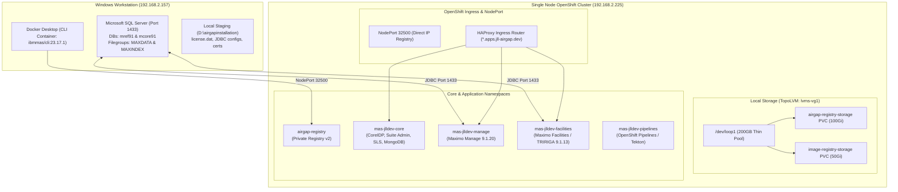
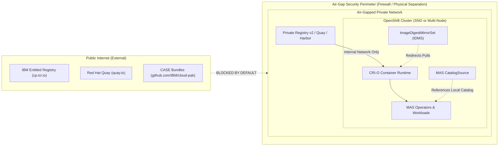
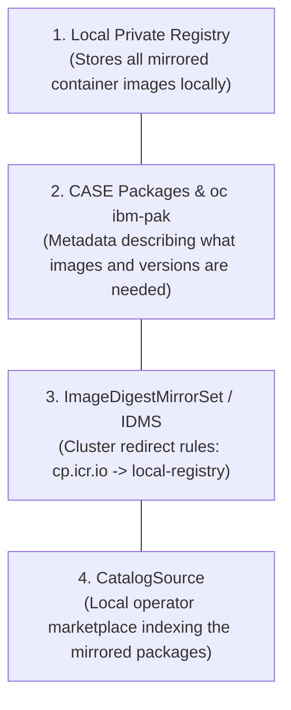
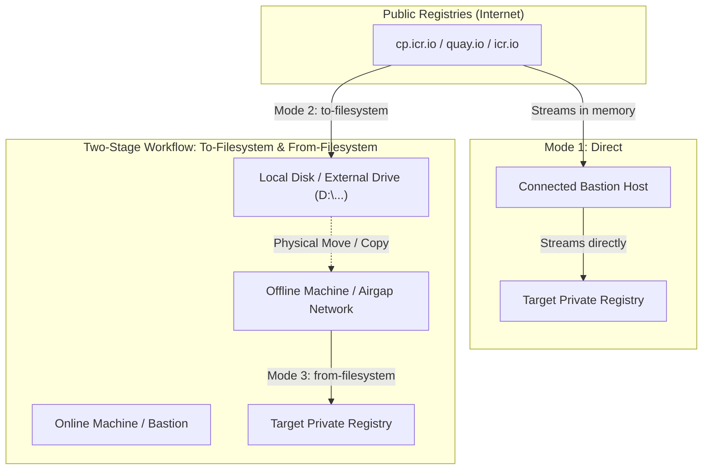
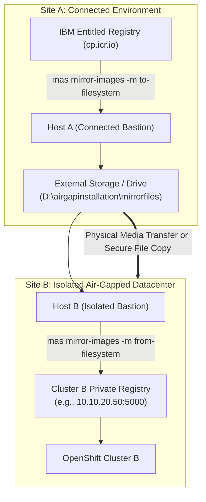
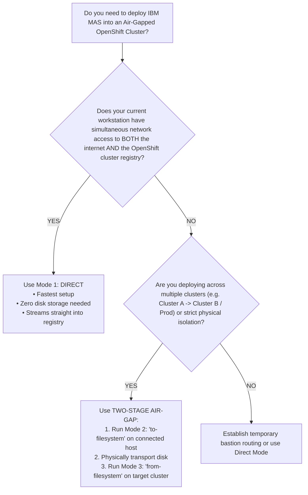

# IBM Maximo Application Suite (MAS 9.1.20) Air-Gap Setup & Installation Runbook

**Target Platform:** Single Node OpenShift (SNO) v4.22.18 on Bare-Metal  
**MAS Version:** 9.1.20 | **Channel:** `9.1.x` | **Catalog:** `v9-260730-amd64`  
**Applications Installed:** Maximo Manage (v9.1.20) & Maximo Facilities (TRIRIGA v9.1.13)  
**Database Backend:** Microsoft SQL Server on Windows Workstation (`192.168.2.157`)  

---

## 1. System Architecture & Topology

The environment is deployed on an air-gapped **Single Node OpenShift (SNO)** cluster hosted on a bare-metal Dell server, supported by an external Windows workstation acting as the bastion host, container runner, and database server.



### Key Environment Specifications

| Component | Specification / Value | Description |
| :--- | :--- | :--- |
| **Cluster Node** | `00-be-43-80-03-43` (`192.168.2.225`) | SNO OpenShift 4.22.18 |
| **API Endpoint** | `https://api.jll-airgap.dev:6443` | Cluster API |
| **Ingress Domain** | `*.apps.jll-airgap.dev` | Wildcard application routes |
| **Bastion Host** | Windows 11 Workstation (`192.168.2.157`) | Docker Desktop & SQL Server |
| **MAS Instance / WS** | Instance: `jlldev` \| Workspace: `dev` | Target suite deployment |
| **Storage Class** | `lvms-vg1` (`topolvm.io`, RWO) | Thin pool backed by `/dev/loop1` |
| **Private Registry** | `192.168.2.225:32500` (`jllairgap`) | LoadBalancer / NodePort service |
| **Registry Credentials**| `jllairgap` / `jllairgap@2026` | Injected into Global Pull Secret |

---

## 2. Pre-requisites & Readiness Audit

Before commencing air-gap mirroring or MAS deployment, verify the following baseline prerequisites:

### A. Windows Bastion & Tooling
1. **Docker Desktop**: Installed and running with Linux container support enabled.
2. **MAS CLI Container**: Image `quay.io/ibmmas/cli:23.17.1` pulled locally.
   - Run container with workspace mounts:
     ```powershell
     docker run -dit --name ibmmas-cli `
       -v D:\airgapinstallation\mirrorfiles:/mnt/registry `
       -v C:\Users\JLLRND1\.kube:/root/.kube `
       quay.io/ibmmas/cli:23.17.1 bash
     ```
3. **OpenShift CLI (`oc`)**: Present inside container and validated:
   ```bash
   oc login -u kubeadmin -p <password> https://api.jll-airgap.dev:6443
   ```

### B. Microsoft SQL Server Setup
Both Maximo Manage and Maximo Facilities require dedicated databases on Microsoft SQL Server:

1. **TCP/IP Protocol**: Must be explicitly enabled in SQL Server Configuration Manager (or Registry) and listening on port `1433`:
   ```powershell
   Set-ItemProperty -Path 'HKLM:\SOFTWARE\Microsoft\Microsoft SQL Server\MSSQL17.MSSQLSERVER\MSSQLServer\SuperSocketNetLib\Tcp' -Name 'Enabled' -Value 1
   Restart-Service MSSQLSERVER -Force
   ```
2. **Databases & Logins**:
   - Maximo Facilities (TRIRIGA): Database `mref91`, Login `mref91`, Password `mref91`.
   - Maximo Manage: Database `mcore91`, Login `mcore91`, Password `mcore91`.
3. **Required Filegroups (Manage Pre-requisite)**:
   Maximo's database installation (`maxinst`) strictly requires two auxiliary filegroups. Execute on `mcore91`:
   ```sql
   ALTER DATABASE [mcore91] ADD FILEGROUP [MAXDATA];
   ALTER DATABASE [mcore91] ADD FILE (NAME = N'mcore91_data', FILENAME = N'D:\MSSQL2025\Data\mcore91_data.ndf', SIZE = 5120MB, FILEGROWTH = 256MB) TO FILEGROUP [MAXDATA];

   ALTER DATABASE [mcore91] ADD FILEGROUP [MAXINDEX];
   ALTER DATABASE [mcore91] ADD FILE (NAME = N'mcore91_idx', FILENAME = N'D:\MSSQL2025\Data\mcore91_idx.ndf', SIZE = 2048MB, FILEGROWTH = 128MB) TO FILEGROUP [MAXINDEX];
   ```

### C. Storage & Hardware Constraints
- **Bare-Metal SNO vs Multi-Node AWS EFS**: Standard IBM guides reference AWS EFS shared storage. On a Dell Bare-Metal SNO, all shared persistent storage is provided via local TopoLVM (`lvms-vg1`). Applications must be configured with `ReadWriteOnce` (RWO) access modes.
- **Node Memory**: SNO requires careful memory quota management. Default bundle requests of 2Gi+ per component can exhaust allocatable RAM.

### D. Licenses & Entitlements
- Staged IBM MAS License File: `license.dat` (stored at `D:\airgapinstallation\mas\license.dat`).
- IBM Entitlement Key: Required during image mirroring from `cp.icr.io`.

---

## 3. Phase 1: Airgap Registry Setup & Storage Resolution

### Step 1: Deploy Private Registry in OpenShift
1. Create namespace `airgap-registry`.
2. Provision a 100Gi PVC `airgap-registry-storage` using StorageClass `lvms-vg1`.
3. Deploy the registry pod and expose it via:
   - **Service `airgap-registry-lb`**: Type `LoadBalancer` mapping port `5000` to NodePort `32500`.
   - **Route `airgap-registry`**: Passthrough route on `airgap-registry.apps.jll-airgap.dev`.

### Step 2: Resolving the LVM Storage Deadlock (Root Cause Analysis)
During setup, `airgap-registry-storage` hung indefinitely in `Pending`. The investigation revealed:
- **Rogue Operator**: A duplicate LVMS operator was installed in `openshift-lvm-storage` targeting `/dev/nvme1n1` (which did not exist).
- **Lock Contention**: The rogue daemon acquired `/var/lock/vgmanager/vgmanager.lock`, causing the legitimate LVMS daemon in `openshift-storage` (`vg-manager-ht4zv`) to stall.
- **Resolution**:
  ```bash
  # 1. Delete broken LVMCluster and CSV in openshift-lvm-storage
  oc delete lvmcluster jll-airgap -n openshift-lvm-storage
  oc delete sub lvms-operator -n openshift-lvm-storage
  oc delete csv lvms-operator.v4.22.0 -n openshift-lvm-storage

  # 2. Release host lock and clean stale device-mapper entries on node
  rm -f /var/lock/vgmanager/vgmanager.lock
  dmsetup remove -f /dev/mapper/vg1-*
  rm -rf /dev/vg1

  # 3. Restart healthy vg-manager daemon
  oc delete pod vg-manager-ht4zv -n openshift-storage
  ```
- **Outcome**: Volume Group `vg1` and `thin-pool-1` initialized successfully on `/dev/loop1`. TopoLVM registered, and PVC bound immediately.

### Step 3: Configure Cluster Trust & Pull Secrets
1. **Extract Registry CA**: Save `ca.crt` to `/mnt/registry/ca.crt`.
2. **Inject into OpenShift Trusted CA**:
   ```bash
   oc create configmap registry-cas -n openshift-config --from-file=192.168.2.225..32500=/mnt/registry/ca.crt
   oc patch image.config.openshift.io/cluster --type=merge -p '{"spec":{"additionalTrustedCA":{"name":"registry-cas"}}}'
   ```
3. **Configure Insecure Registry Bypass for Node CRI-O**:
   Because Go's TLS validator rejects IP SAN certificates when accessed via raw IP, configure CRI-O insecure registry:
   ```bash
   oc patch image.config.openshift.io/cluster --type=merge -p '{"spec":{"registrySources":{"insecureRegistries":["192.168.2.225:32500"]}}}'
   ```
4. **Update Global Cluster Pull Secret**:
   Add base64 credentials for `192.168.2.225:32500` (`user: jllairgap`, `password: jllairgap@2026`) into `openshift-config/pull-secret`.

---

## 4. Phase 2: Image Mirroring Deep Dive

### Understanding Mirror Modes

The MAS CLI provides three distinct mirroring operations:

```
                  +----------------------------------------------+
                  |         Remote Internet Registries          |
                  |         (cp.icr.io / quay.io)                |
                  +----------------------------------------------+
                               /                   \
                 Mode 1: Direct                     Mode 2: To-Filesystem
                             /                       \
                            v                         v
              +--------------------------+     +--------------------------+
              | Target Private Registry  |     |   Local Disk / Storage   |
              | (192.168.2.225:32500)    |     | (/mnt/registry / D:\...) |
              +--------------------------+     +--------------------------+
                            ^                         |
                             \                       /
                              \                     /
                             Mode 3: From-Filesystem
```

1. **Mode 1 (`direct`)**: Streams images straight from IBM/Quay into the private registry without saving intermediate files to disk. Ideal when the bastion has network access to both the internet and OpenShift.
2. **Mode 2 (`to-filesystem`)**: Downloads images from IBM/Quay into local files (`D:\airgapinstallation\mirrorfiles`). Requires internet access and Entitlement Key.
3. **Mode 3 (`from-filesystem`)**: Pushes local image files from disk into the private registry. Requires only private registry access (no internet required).

### Execution Parameters for `mas mirror-images`

#### Catalog Metadata Patch for OCP 4.22
Because MAS CLI `23.17.1` officially catalogues support up to OCP `4.21`, patch the catalog loader inside the container:
```python
# patch_catalog.py
import json
with open('/mascli/catalog/v9-260730-amd64.json', 'r') as f:
    data = json.load(f)
if "4.22" not in data["ocp_compatibility"]:
    data["ocp_compatibility"].append("4.22")
with open('/mascli/catalog/v9-260730-amd64.json', 'w') as f:
    json.dump(data, f)
```

#### Running the Mirror Process
To execute image mirroring (Direct Mode):
```bash
mas mirror-images \
  -m direct \
  -d /mnt/registry \
  -H 192.168.2.225 \
  -P 32500 \
  -x jllairgap \
  -u jllairgap \
  -p jllairgap@2026 \
  -c v9-260730-amd64 \
  -C 9.1.x \
  --ibm-entitlement <YOUR_IBM_ENTITLEMENT_KEY> \
  --mirror-catalog \
  --mirror-core \
  --mirror-manage \
  --mirror-facilities \
  --mirror-sls \
  --mirror-tsm \
  --mirror-mongo \
  --mirror-odf \
  --mirror-cli \
  --no-confirm
```

#### Mirrored Artifacts & Versions
- **Catalog**: `v9-260730-amd64`
- **MAS Core Platform**: `9.1.20`
- **Maximo Manage**: `9.1.20`
- **Maximo Facilities (MREF)**: `9.1.13`
- **Dependencies**: SLS `3.13.0`, TSM `1.7.7`, MongoDB CE `8.0.23`, ODF `4.15`
- **ImageDigestMirrorSet (IDMS)**: Applied `mas-ibm-catalog-jllairgap` to redirect all image pulls from `cp.icr.io` to `192.168.2.225:32500/jllairgap`.

---

## 5. Phase 3: Pre-Installation Cluster Services

### 1. OpenShift Pipelines (Tekton) Deployment
MAS deployment utilizes Tekton pipelines under the hood:
1. Installed **Red Hat OpenShift Pipelines Operator** v1.24.3 in `openshift-operators`.
2. Verified all Tekton control plane pods (`pipelines`, `triggers`, `chains`) reached `1/1 Running`.

### 2. OpenShift Internal Image Registry Setup
Maximo Manage builds custom Liberty and DB container images directly on the cluster during workspace initialization. This requires the internal cluster image registry to be operational:
1. Provisioned a 50Gi PVC `image-registry-storage` on `lvms-vg1`.
2. Configured the registry operator:
   ```bash
   oc patch configs.imageregistry.operator.openshift.io/cluster --type=merge -p '{
     "spec": {
       "managementState": "Managed",
       "rolloutStrategy": "Recreate",
       "storage": {
         "pvc": {
           "claim": "image-registry-storage"
         }
       },
       "defaultRoute": true
     }
   }'
   ```
3. Verified `image-registry.openshift-image-registry.svc:5000` is active.

### 3. Staging Application Configurations

Staged in `D:\airgapinstallation\mas\` (mounted to `/mnt/registry/mas/` in the CLI container):

#### A. Facilities Configuration (`facilities-config.yaml`)
```yaml
apiVersion: v1
kind: ConfigMap
metadata:
  name: facilities-config
  namespace: mas-jlldev-pipelines
data:
  mas_ws_facilities_storage_log_size: "30"
  mas_ws_facilities_storage_userfiles_size: "50"
  mas_ws_facilities_db_maxconnpoolsize: "200"
  mas_ws_facilities_dwfagents: "[]"
```

#### B. Facilities SQL Server JDBC (`jdbc-jlldev-facilities.yaml`)
```yaml
apiVersion: config.mas.ibm.com/v1
kind: JdbcCfg
metadata:
  name: jlldev-facilities-jdbc
  namespace: mas-jlldev-core
spec:
  config:
    url: "jdbc:sqlserver://192.168.2.157:1433;databaseName=mref91;encrypt=false;trustServerCertificate=true;"
    user: "mref91"
    password: "mref91"
  scope: "workspace"
  workspaceId: "dev"
```

#### C. Manage SQL Server JDBC (`jdbc-jlldev-manage.yaml`)
```yaml
apiVersion: config.mas.ibm.com/v1
kind: JdbcCfg
metadata:
  name: jlldev-manage-jdbc
  namespace: mas-jlldev-core
spec:
  config:
    url: "jdbc:sqlserver://192.168.2.157:1433;databaseName=mcore91;encrypt=false;trustServerCertificate=true;"
    user: "mcore91"
    password: "mcore91"
  scope: "workspace"
  workspaceId: "dev"
```

---

## 6. Phase 4: MAS Pipeline Installation (`mas install`)

### Executing the Installer
Launch the installation from the CLI container:
```bash
mas install \
  --mas-instance-id jlldev \
  --mas-workspace-id dev \
  --mas-workspace-name "JLL Development" \
  --mas-catalog-version v9-260730-amd64 \
  --mas-channel 9.1.x \
  --license-file /mnt/registry/mas/license.dat \
  --ibm-entitlement <YOUR_KEY> \
  --storage-class lvms-vg1 \
  --storage-accessmode ReadWriteOnce \
  --install-manage \
  --install-facilities
```

### Pipeline Tasks Executed (PipelineRun `jlldev-install-261103-1255-00eq0h`)
1. `pipeline-start`: Initializes workspace config.
2. `ibm-catalogs`: Injects offline CatalogSources backed by mirrored registry.
3. `cert-manager` & `suite-certs`: Provisions cluster-issuer and TLS certificates.
4. `mongodb`: Provisions MongoDB Community Edition 8.0 cluster for suite metadata.
5. `sls`: Deploys Suite License Service and bootstraps `license.dat`.
6. `dro` & `bas`: Installs Data Reporter Operator and Business Activity Services.
7. `suite-install`: Deploys IBM MAS Core Operator and reconciles Suite CR `jlldev`.
8. `suite-config`: Binds SLS, MongoDB, and SystemDB to MAS Core.
9. `app-install-manage`: Generates Manage build configs, runs `maxinst`, and provisions bundle pods.
10. `app-install-facilities`: Provisions TRIRIGA data initialization, runs schema updates, and deploys Liberty app servers.

---

## 7. Critical Post-Install Blockers & Remediation

During the automated rollout, multiple environmental and configuration issues occurred and were resolved:

### 1. SQL Server Missing Filegroup Error in Maximo Manage
- **Symptom**: `app-install-manage` task failed during `maxinst.sh` with:
  ```
  Invalid filegroup 'MAXDATA' specified.
  ```
- **Root Cause**: Maximo Manage DDL requires SQL Server tables and indexes to be partitioned across `MAXDATA` and `MAXINDEX` filegroups. Default database creation only provides `PRIMARY`.
- **Fix**: Executed DDL on Windows SQL Server (`192.168.2.157`) to create the filegroups and add physical data files to `mcore91`.

### 2. Single Node OpenShift Memory Deadlock (`ManageServerBundle/all`)
- **Symptom**: Maximo Manage server bundle pod `jlldev-dev-all-dddc9cd55-gwd6f` stuck in `Pending`:
  ```
  0/1 nodes available: 1 Insufficient memory.
  ```
- **Root Cause**: The operator requested 2Gi of memory for the `all` container and 500Mi for `monitoragent`. SNO allocatable memory was at 1.98Gi available.
- **Fix**: Patched `ManageServerBundle/all` and its deployment resource requests:
  ```bash
  oc patch manageserverbundle jlldev-dev-all -n mas-jlldev-manage --type=merge -p '{
    "spec": {
      "settings": {
        "resources": {
          "requests": {"cpu": "100m", "memory": "50Mi"}
        }
      }
    }
  }'
  ```
- **Result**: Pod immediately scheduled and transitioned to `2/2 Running`. Internal ping verified:
  ```bash
  curl -ksi https://localhost:9443/maximo/api/ping?ready=1
  # Returned: HTTP/1.1 200 OK {"mxserverstarted": true}
  ```

### 3. Facilities Storage Access Mode Mismatch (RWX vs RWO)
- **Symptom**: TRIRIGA appserver PVCs failed to bind.
- **Root Cause**: Operator default templates requested `ReadWriteMany` (RWX), which is unsupported by the local TopoLVM driver (`lvms-vg1`).
- **Fix**: Re-created PVC definitions (`log-jlldev-dev-appserver-0`, `userfiles-jlldev-dev-appserver-0`, `jlldev-dev-multiagents-log`, `jlldev-dev-multiagents-userfiles`) with `accessModes: ["ReadWriteOnce"]`.

### 4. CoreIDP Startup Probe Timeout & API Warmup
- **Symptom**: `https://admin.jlldev.apps.jll-airgap.dev` displayed OpenShift error:
  ```
  Application is not available (503 Service Unavailable)
  ```
- **Root Cause**: `jlldev-coreidp` was cold-starting its internal JAX-RS services (`api-usermgmt-internal`). The initial response took 43 seconds, exceeding the default 20-second startup probe timeout and causing kubelet to restart the container in a loop.
- **Fix**: Increased probe timeouts and executed direct warm-up curl requests against `api/probes/readiness` and `idplogin/probes/readiness`. Response time dropped to <2s, and `coreidp` reached `1/1 Running`.

### 5. Windows Client DNS Resolution (`DNS_PROBE_FINISHED_NXDOMAIN`)
- **Symptom**: Browsing to `auth.jlldev.apps.jll-airgap.dev` failed on Windows with `DNS_PROBE_FINISHED_NXDOMAIN`.
- **Root Cause**: Windows `hosts` file had invalid entries (wildcards like `*.apps...` and URL paths with `/login` are not supported by the Windows DNS resolver).
- **Fix**: Created and executed the automation script [`update_hosts.ps1`](file:///C:/Users/JLLRND1/update_hosts.ps1) to inject clean, exact FQDN mappings pointing to `192.168.2.225`.

---

## 8. Verified Endpoints & Credentials

### Access Endpoints

| Service | URL | Status |
| :--- | :--- | :--- |
| **OpenShift Web Console** | `https://console-openshift-console.apps.jll-airgap.dev/dashboards` | Online |
| **MAS Admin Console** | `https://admin.jlldev.apps.jll-airgap.dev` | Online (HTTP 200) |
| **MAS Authentication** | `https://auth.jlldev.apps.jll-airgap.dev/login` | Online (HTTP 200) |
| **MAS Suite Homepage** | `https://home.jlldev.apps.jll-airgap.dev` | Online (HTTP 200) |
| **Maximo Manage** | `https://dev.manage.jlldev.apps.jll-airgap.dev/maximo/` | Online (HTTP 302 -> UI) |
| **Maximo Facilities** | `https://dev.facilities.jlldev.apps.jll-airgap.dev` | Running Schema Update |

### Superuser Administrator Credentials
- **Username:** `p03cfCCiso0Jafv9gbDeiQd1nKpOUb9n`
- **Password:** `o47cUm3iOxKDgwn1iXB4O04dsQho5gZr`

---

## 9. Appendix: Maintenance & Useful CLI Commands

### Checking System Health
```bash
# Check all MAS Core pods
docker exec b1094b67fd06 oc get pods -n mas-jlldev-core

# Check Maximo Manage pod and ping status
docker exec b1094b67fd06 oc get pods -n mas-jlldev-manage
docker exec b1094b67fd06 oc exec -n mas-jlldev-manage deployment/jlldev-dev-all -c all -- curl -ksi https://localhost:9443/maximo/api/ping?ready=1

# Check Facilities appserver logs
docker exec b1094b67fd06 oc logs jlldev-dev-appserver-0 -n mas-jlldev-facilities -c appserver --tail=50
```

### Windows DNS Refresh
```powershell
# In an elevated PowerShell prompt on the Windows workstation:
.\update_hosts.ps1
ipconfig /flushdns
```


# IBM Maximo Application Suite (MAS) & OpenShift: Complete Air-Gap Architecture & Mirroring Guide

**Scope:** Enterprise Air-Gap Architecture, Mirroring Modes (`direct`, `to-filesystem`, `from-filesystem`), Multi-Cluster Portability, and OpenShift Cluster Onboarding.

---

## 1. Executive Summary & Core Air-Gap Concepts

### What is an "Air-Gap" Environment?
An **air-gapped** (or disconnected) environment is a computing infrastructure physically or logically isolated from the public internet. Nodes, workloads, and control planes within an air-gapped network have **zero outbound or inbound internet connectivity**.

In modern enterprise architectures, air-gapping is mandated for:
- **Security & Zero Trust:** Eliminating attack surfaces, supply-chain vulnerabilities, and unauthorized data exfiltration.
- **Compliance & Regulation:** Defense, government, healthcare, nuclear, banking, and critical infrastructure (SOC2, FedRAMP, ISO 27001).
- **Network Sovereignty:** Self-contained environments that must remain fully functional regardless of upstream internet outages.



---

### The Disconnected OpenShift Challenge

By default, containerized platforms like OpenShift and Kubernetes assume unrestricted access to public registries:
- Operators pull from `quay.io/openshift-release-dev/...`
- IBM MAS software pulls from `cp.icr.io/cp/...`
- Red Hat Catalogs pull from `registry.redhat.io/...`

When internet access is severed, every `pod create` or `image pull` fails immediately with `ErrImagePull` or `ImagePullBackOff`. To overcome this, the platform requires an **Enterprise Air-Gap Architecture** built on four foundational pillars:



1. **Private Container Registry (Mirror Registry):** A secure, local container registry (e.g., Docker Registry v2, Quay Enterprise, Harbor, or OpenShift In-Cluster Registry) hosted inside the firewall.
2. **CASE Bundles (`oc ibm-pak`):** Container Application Software for Enterprise (CASE) packages. These are signed specification archives detailing every image digest, Helm chart, dependency, and configuration parameter needed by MAS.
3. **Cluster Pull Redirection (`ImageDigestMirrorSet` / IDMS):** A cluster-wide OpenShift rule. When an operator requests `cp.icr.io/cp/manage/maximo:9.1.20`, the OpenShift CRI-O runtime automatically rewrites the request to `192.168.2.225:32500/jllairgap/cp/manage/maximo:9.1.20`.
4. **Offline CatalogSource:** A custom operator catalog pointing to the locally mirrored catalog image (`ibm-maximo-operator-catalog`) rather than IBM's cloud catalog.

---

## 2. Comparison of Mirroring Modes

The MAS CLI provides three distinct mirroring operations via `mas mirror-images`:



### Technical Feature Matrix

| Feature | Mode 1: `direct` | Mode 2: `to-filesystem` | Mode 3: `from-filesystem` |
| :--- | :--- | :--- | :--- |
| **Primary Action** | Stream remote -> local registry | Download remote -> local disk | Push local disk -> local registry |
| **Internet Access** | **Required** | **Required** | **Not Required (Fully Offline)** |
| **Registry Access** | **Required** | Not Required | **Required** |
| **Host Disk Space** | Minimal (~a few MBs for logs) | **High (50 GB - 300 GB)** | Existing disk storage |
| **Execution Phase** | Single-step | Stage 1 (Connected side) | Stage 2 (Disconnected side) |
| **Network Topology** | "Semi-airgap" / Bastion on both nets | Internet-connected laptop / DMZ | Strictly isolated private network |
| **Multi-Cluster Use** | Must re-stream for each cluster | **Reusable across infinite clusters** | Run once per cluster |

---

## 3. Mode 1: Direct Mirroring (`direct`)

### Architecture & Mechanics
In `direct` mode, the host machine running the MAS CLI must have two network routes active simultaneously:
1. Outbound routing to the **Internet** (to authenticate with IBM Entitled Registry `cp.icr.io`).
2. Inbound routing to the **Internal Private Registry** (e.g. `192.168.2.225:32500`).

Images are pulled layer-by-layer into host RAM/temporary container buffer and pushed immediately to the target private registry. **No image tarballs or blob files are persisted on the host disk.**

```
[IBM Registry (cp.icr.io)] ──(Internet)──> [Docker Host] ──(LAN / VPN)──> [Cluster Registry]
```

### Execution Procedure

#### Method A: Interactive Wizard
```bash
mas mirror-images
```
1. **Catalog Version:** `v9-260730-amd64`
2. **Channel:** `9.1.x`
3. **Working Directory:** `/mnt/registry`
4. **Mirror Mode:** `1` *(Direct)*
5. **Mirror Registry Host:** `192.168.2.225`
6. **Mirror Registry Port:** `32500`
7. **Mirror Registry Prefix:** `jllairgap`
8. **Mirror Registry Username:** `jllairgap`
9. **Mirror Registry Password:** `jllairgap@2026`
10. **IBM Entitlement Key:** `<YOUR_IBM_KEY>`
11. **Select Components:** Choose components (Catalog, Core, Manage, Facilities, Dependencies).

#### Method B: Automated CLI Command
```bash
mas mirror-images \
  -m direct \
  -d /mnt/registry \
  -H 192.168.2.225 \
  -P 32500 \
  -x jllairgap \
  -u jllairgap \
  -p jllairgap@2026 \
  -c v9-260730-amd64 \
  -C 9.1.x \
  --ibm-entitlement <YOUR_IBM_KEY> \
  --mirror-catalog \
  --mirror-core \
  --mirror-manage \
  --mirror-facilities \
  --mirror-sls \
  --mirror-tsm \
  --mirror-mongo \
  --mirror-odf \
  --mirror-cli \
  --no-confirm
```

> [!TIP]
> **Best For:** Fast initial setups where the workstation (e.g., Windows workstation `192.168.2.157`) sits on the same local subnet as the OpenShift node (`192.168.2.225`) while retaining internet access.

---

## 4. Mode 2: Mirroring to Filesystem (`to-filesystem`)

### Architecture & Mechanics
`to-filesystem` is **Stage 1** of a true physical air-gap deployment. It runs on an internet-connected workstation, staging server, or laptop.

The command performs two critical operations:
1. **Pulls Container Layers:** Connects to `cp.icr.io`, `quay.io`, and downloads image layers directly into a local folder structure (`$MIRROR_WORKING_DIR`).
2. **Generates Mirror Manifests:** Uses `oc ibm-pak` to generate `images-mapping-to-filesystem.txt` and `images-mapping-from-filesystem.txt`.

```
[IBM Registry (cp.icr.io)] ──(Internet)──> [Connected Host] ──(Disk Write)──> [Local / External Drive]
```

### Storage Directory Structure on Disk
When saved to disk (e.g. `D:\airgapinstallation\mirrorfiles`), the directory is structured as follows:

```
D:\airgapinstallation\mirrorfiles/
├── manifests/
│   ├── to-filesystem/
│   │   ├── catalog_v9-260730-amd64.txt       # Mapping from internet -> file://
│   │   ├── ibm-mas_9.1.20.txt
│   │   ├── ibm-mas-manage_9.1.20.txt
│   │   └── ibm-mas-facilities_9.1.13.txt
│   └── from-filesystem/
│       ├── catalog_v9-260730-amd64.txt       # Mapping from file:// -> Target Registry
│       ├── ibm-mas_9.1.20.txt
│       ├── ibm-mas-manage_9.1.20.txt
│       └── ibm-mas-facilities_9.1.13.txt
├── v2/                                        # OCI Image Blobs and Manifests
│   ├── blobs/sha256/
│   └── repositories/
└── logs/
```

### Capacity Planning Guidelines
- **Catalog + MAS Core + Dependencies (SLS, Mongo):** ~60 GB – 80 GB
- **Maximo Manage:** ~50 GB – 70 GB
- **Maximo Facilities (TRIRIGA):** ~20 GB – 30 GB
- **Recommended Free Disk Space:** Minimum **200 GB – 300 GB** on the staging drive.

### Execution Procedure

```bash
mas mirror-images \
  -m to-filesystem \
  -d /mnt/registry \
  -H 192.168.2.225 \
  -P 32500 \
  -x jllairgap \
  -c v9-260730-amd64 \
  -C 9.1.x \
  --ibm-entitlement <YOUR_IBM_KEY> \
  --mirror-catalog \
  --mirror-core \
  --mirror-manage \
  --mirror-facilities \
  --mirror-sls \
  --mirror-tsm \
  --mirror-mongo \
  --mirror-odf \
  --mirror-cli \
  --no-confirm
```

> [!NOTE]
> In `to-filesystem`, no registry username/password is required because the tool is not writing to any remote registry—only to the local disk.

---

## 5. Mode 3: Mirroring from Filesystem (`from-filesystem`)

### Architecture & Mechanics
`from-filesystem` is **Stage 2** of the true physical air-gap workflow. It is executed **inside the secure air-gapped network**.

1. You disconnect the external drive (or move the staging folder) past the security barrier.
2. Mount the folder into your air-gapped bastion host or CLI container (`/mnt/registry`).
3. The command reads the raw container blobs from the drive and uploads them into the internal cluster registry.
4. **Zero internet requests are initiated.**

```
[Local / External Drive] ──(Disk Read)──> [Air-Gapped Host] ──(Local Network)──> [Cluster Registry]
```

### Execution Procedure

```bash
mas mirror-images \
  -m from-filesystem \
  -d /mnt/registry \
  -H 192.168.2.225 \
  -P 32500 \
  -x jllairgap \
  -u jllairgap \
  -p jllairgap@2026 \
  -c v9-260730-amd64 \
  -C 9.1.x \
  --mirror-catalog \
  --mirror-core \
  --mirror-manage \
  --mirror-facilities \
  --mirror-sls \
  --mirror-tsm \
  --mirror-mongo \
  --mirror-odf \
  --mirror-cli \
  --no-confirm
```

> [!IMPORTANT]
> Because this step runs inside the air-gapped network, **no IBM Entitlement Key is required**. You only provide authentication for your local private registry (`jllairgap` / `jllairgap@2026`).

---

## 6. The Multi-Cluster Airgap Scenario (Cluster A -> Filesystem -> Cluster B)

A frequent enterprise requirement is:
> *"We want to download the images once to the filesystem from our internet-connected site (Host/Cluster A), and then use those same files to configure and deploy Cluster B (e.g., QA, Prod, or an isolated client datacenter)."*



### Why is This 100% Feasible?
1. **Content-Addressable Storage (Immutable Blobs):** Container images are structured as cryptographic sha256 hashes (`sha256:8b78bc12...`). An image blob for Maximo Manage 9.1.20 downloaded on Site A is bit-for-bit identical to the image needed on Site B.
2. **Zero Cluster Couplings in Raw Images:** The downloaded image files on disk contain no hostname, IP address, or cluster name bindings.

---

### Handling Target Registry Differences for Cluster B

When `to-filesystem` was run on Host A, it generated `manifests/from-filesystem/*.txt`. The right-hand side of each mapping contains the target registry specified at download time:
```text
file:///cpopen/ibm-maximo-operator-catalog@sha256:... = 192.168.2.225:32500/jllairgap/cpopen/...
```

If Cluster B uses a **different** registry IP or hostname (for example: `10.10.20.50:5000` or `registry.cluster-b.internal`), you have two simple ways to handle it:

#### Strategy 1: Specify Cluster B's Address During `to-filesystem` (Easiest)
If you already know Cluster B's future registry endpoint, input Cluster B's registry host and port when running `to-filesystem` on Host A. The generated `from-filesystem` manifests will already be pre-configured for Cluster B!

#### Strategy 2: Batch Update Manifests on Cluster B (If Registry Differs)
If Cluster B's registry address changed or was unknown during the download, update the manifest files on Host B before running `from-filesystem`:

```bash
# Example: Replacing Cluster A IP (192.168.2.225:32500) with Cluster B IP (10.10.20.50:5000)
cd /mnt/registry/manifests/from-filesystem/
sed -i 's/192.168.2.225:32500/10.10.20.50:5000/g' *.txt
```

Now, when `mas mirror-images -m from-filesystem` executes, it will upload all disk images directly into Cluster B's registry!

---

### Cluster B Onboarding Checklist (OpenShift Configuration)

Before running `mas install` on Cluster B, perform the following cluster configurations:

#### 1. Configure OpenShift Trust for Cluster B's Registry
If Cluster B's registry uses a self-signed or internal CA, inject the certificate into OpenShift's cluster-wide trust bundle:
```bash
oc create configmap registry-cas -n openshift-config \
  --from-file=10.10.20.50..5000=/mnt/registry/cluster-b-ca.crt

oc patch image.config.openshift.io/cluster --type=merge \
  -p '{"spec":{"additionalTrustedCA":{"name":"registry-cas"}}}'
```

#### 2. Configure Insecure Registry (If Using NodePort / Raw IP)
If accessing the registry via IP instead of a verified DNS domain name:
```bash
oc patch image.config.openshift.io/cluster --type=merge \
  -p '{"spec":{"registrySources":{"insecureRegistries":["10.10.20.50:5000"]}}}'
```

#### 3. Update Cluster B's Global Pull Secret
Cluster nodes must be authorized to pull from Cluster B's registry:
```bash
# 1. Extract existing secret
oc get secret pull-secret -n openshift-config -o jsonpath='{.data.\.dockerconfigjson}' | base64 -d > /tmp/pull-secret.json

# 2. Add Cluster B registry credentials using podman or jq
podman login --authfile /tmp/pull-secret.json -u <user> -p <pass> 10.10.20.50:5000

# 3. Update cluster secret
oc set data secret/pull-secret -n openshift-config --from-file=.dockerconfigjson=/tmp/pull-secret.json
```

#### 4. Apply the ImageDigestMirrorSet (IDMS)
Apply the generated IDMS so OpenShift intercepts calls to `cp.icr.io` and routes them to Cluster B:
```yaml
apiVersion: config.openshift.io/v1
kind: ImageDigestMirrorSet
metadata:
  name: mas-ibm-catalog-cluster-b
spec:
  imageDigestMirrors:
    - mirrors:
        - 10.10.20.50:5000/jllairgap/cpopen
      source: icr.io/cpopen
    - mirrors:
        - 10.10.20.50:5000/jllairgap/cp
      source: cp.icr.io/cp
```

#### 5. Inject Offline CatalogSource on Cluster B
```yaml
apiVersion: operators.coreos.com/v1alpha1
kind: CatalogSource
metadata:
  name: ibm-operator-catalog
  namespace: openshift-marketplace
spec:
  displayName: IBM Operator Catalog (Offline)
  publisher: IBM
  sourceType: grpc
  image: 10.10.20.50:5000/jllairgap/cpopen/ibm-maximo-operator-catalog:v9-260730-amd64
  updateStrategy:
    registryPoll:
      interval: 45m
```

Once verified (`oc get catalogsource -n openshift-marketplace` shows `READY`), Cluster B is fully primed to run `mas install`.

---

## 7. Troubleshooting & Operational Best Practices

### A. Windows & Docker Disk Space Exhaustion
When downloading 150+ GB of images in `to-filesystem`:
- **The Pitfall:** Docker Desktop's default virtual disk (`vhdx`) resides on `C:\`. If you run `to-filesystem` without mounting the external drive, your Windows `C:` drive will quickly hit 100% full.
- **The Remedy:** Always mount an external or high-capacity drive (e.g. `D:\airgapinstallation\mirrorfiles`) directly into the container volume mount:
  ```powershell
  -v D:\airgapinstallation\mirrorfiles:/mnt/registry
  ```
  And verify `--dir=/mnt/registry` is used.

### B. Go TLS Certificate Rejection on IP Endpoints
- **The Pitfall:** If your registry endpoint is an IP address (`192.168.2.225:32500`), Go's internal crypto library rejects IP certificates unless the certificate contains an exact **Subject Alternative Name (SAN) of type IP**.
- **The Remedy:** Add the IP and port to `insecureRegistries` in `image.config.openshift.io/cluster`. This allows the CRI-O daemon on the OpenShift node to pull images over TLS while bypassing IP SAN validation.

### C. Single Node OpenShift (SNO) Resource Management
- **The Pitfall:** In SNO, every control plane and application pod shares the same physical node. MAS operators default to multi-node enterprise resource allocations (e.g., 2Gi - 4Gi RAM per pod).
- **The Remedy:** Before or during installation, patch `ManageServerBundle` and deployment manifests to reduce initial `requests` while maintaining reasonable `limits`:
  ```bash
  requests: { cpu: "100m", memory: "50Mi" }
  ```

---

## 8. Summary Decision Flowchart

Use this decision tree to select the appropriate mirroring strategy for your engagement:



